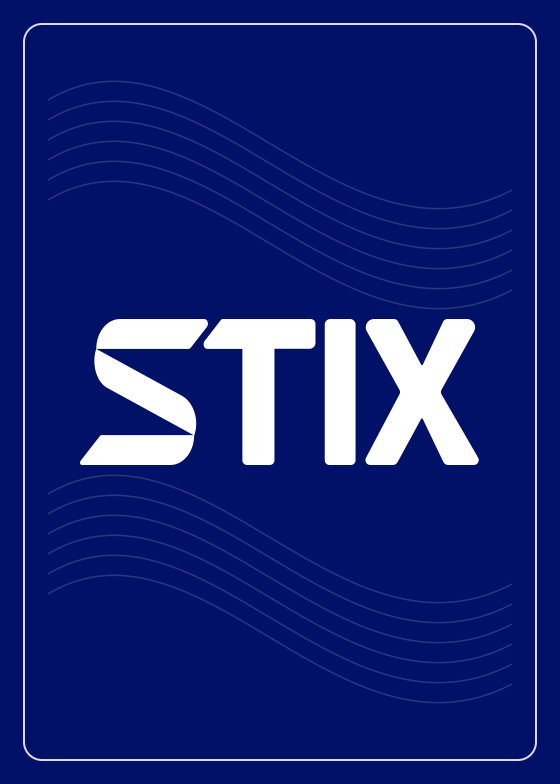

# STIX Lid Effects

Native MacBook lid effects, based on [Mac Duo by Makito](https://github.com/sumimakito/Mac-Duo), Apache 2.0. macOS 14 or newer.

- Mini control window from the menu bar.
- Twelve selectable effects: CRT, frosted glass, waves, paper fold, particles, edge light, cinematic fade, cracking glass with falling shards, a flying deck of playing cards, a three-pass paint roller, 5,000-ruble banknotes and $100 banknotes; original Duo remains available.
- **Option+B** toggles live Gaussian blur of real windows on every connected display (15 fps, neutral colour, 14 pt radius). **Escape does not dismiss it.** While active, input is suppressed except Option+B. A frozen cursor image is composited into the source before blur; the real pointer is hidden using a transparent cursor and cursor rectangles on the overlay. Images stay in memory; they are never saved or uploaded. This is a visual effect, not a screen lock.
- **Option+M** plays the selected effect across every display and holds a fully black screen until Option+M is pressed again. Repeat the shortcut during animation to reverse smoothly from the current frame. Repeat it from held black to play the same effect in reverse over freshly captured windows. While black, Option+B does not reveal the screen. Black windows require no ongoing capture or GPU animation. During the manual effect and restoration, only Option+M passes through the input shield and the cursor is hidden.
- **Колода карт** breaks the desktop into 52 cards at the original 13-by-4 size and reveals 156 ordinary cards behind the screen plane. Only the first deck has desktop-fragment backs; additional decks have independent STIX navy (#001167) backs with the original white wordmark and flowing line artwork and the same vector-drawn ranks, suits and court figures. Cards flip and fly toward the viewer at twice the original flight rate, with staggered launches throughout the same 3.4-second duration, near-plane clipping and depth-tested overlap. Option+M/pinch reverses the 3.4-second scene to restore the desktop. No external images or network downloads are used.
- **Рубли · 5 000 ₽** and **Доллары · $100** use the same reversible 3D flight as the cards, with wide banknote proportions and a slight paper curl. Each effect has 48 desktop-fragment notes and 144 independent notes behind them, with original locally drawn front/back illustrations: warm brown bridge/monument artwork for rubles, green portrait/building artwork with a blue ribbon for dollars. The 3.4-second flight holds black and reverses with Option+M/pinch. No downloaded currency scans or network access.
- **Малярный валик** paints the desktop black in three overlapping horizontal passes: right, left, right. A shaded black roller with chrome arm and navy grip changes rows outside the screen. Already painted bands stay black; untouched windows remain clear. Option+M/pinch holds black after 4.2 seconds and reverses the roller to reveal freshly captured windows. The same progress-based scene works with lid movement.
- The cracking-glass effect reveals cracks spreading from an impact point, then drops independent Voronoi glass plates: fine chips around the impact, larger plates at the edges, staggered release, ballistic motion, 3D rotation, dark backs and refractive edge highlights. Depth testing handles overlapping fragments. The manual glass sequence lasts three seconds.
- Separate **Матовое покрытие** button provides a visual nano-texture-style coating: stationary neutral fine grain, gentle tonal softening, no text blur. Strength is adjustable from 15% to 100%; intensity and enabled state are saved. It is a transparent click-through layer with no capture stream, input suppression or rendering timer. It does not change the display glass or remove physical reflections. Manual blur/blackout cover it normally.
- Optional **Жесты через камеру**: hold a thumb/index pinch for Option+M or an open palm for Option+B. Hold for about 0.7 seconds, then remove the hand or relax to an unrecognised pose for at least 0.45 seconds before repeating. Only one visible hand is accepted. Gesture commands share the shortcut mode guards and remain usable while hardware input is shielded. Hotkeys remain available.
- Camera frames are processed locally by Apple Vision at up to 15 analyses per second, using a small video stream. No video recording, uploads, microphone access or face recognition. The toggle persists only after camera access succeeds; capture stops on sleep, shutdown, errors or toggle-off.
- Login startup via SMAppService, with an on/off switch.
- Only the overlay windows are excluded from capture; the control panel and other app windows remain visible under the blur.
- Sleep and display changes dismiss manual blur to prevent stale overlays. Option+M blackout remains latched and covers the updated display layout until toggled off.
- Lid effects require a built-in lid angle sensor. Manual blur works independently.

## STIX card artwork



The additional rear decks use STIX artwork drawn locally from vector outlines, following the 2026 logobook. The logobook itself is not distributed. The primary 52 cards retain desktop-fragment backs. STIX names and marks identify the project; the code license does not grant trademark rights.

## Build and install

Run `swift test`, then `./build.sh`. Copy `build/STIX Lid Effects.app` into Applications and launch. For a stable signed local build, set `SIGN_IDENTITY` to your Developer ID identity before running the build script. Grant Screen Recording permission to **STIX Lid Effects**, then restart it if macOS requests this. Also enable the app in Privacy & Security → Accessibility to use the manual input shield. Local builds are not notarized automatically.

The app registers Option+B and Option+M using Carbon, with key-release tracking to prevent repeated toggles while a key is held. Accessibility permission is required for the temporary input shield. The HID event tap does not record input and is removed when the mode ends; cursor visibility and the previously active application are restored. Tap failure cancels the mode and restores control. If another app has reserved this shortcut, the mini window reports the conflict. Close the mini window to leave the menu bar utility running; use its Quit button to exit.

Camera gestures require Camera permission. Enable **Жесты через камеру** and accept the macOS prompt. The status line and hold-progress indicator help position the hand. Recognition depends on lighting, framing and hand visibility; registration is not needed.

## Verification

`swift test` covers the existing lid policies and localization, progress validation, shader compilation and GPU-rendered frames for all effects. Pixel tests verify a clear desktop at zero progress, distinct intermediate effects, visible cracking/falling stages and completely black final frames for every manual effect. State tests verify preparation cancellation, indefinite black-screen hold, reverse playback and continuous direction changes. Input-policy tests verify the mode-specific exit shortcut, blocked keys, pointer/scroll/gesture events, and the blurred-cursor compositing test verifies that the pointer is part of the source image.

## Upstream documentation

<div align="center">

# Mac Duo

**Wish you could bring the iPhone Duo effect to your MacBook?**

https://github.com/user-attachments/assets/3ea3b098-c6d2-4398-8f3a-e9087bbb33f2

Close the lid and watch your screen content tilt, blur, and fade as it moves.  
Mac Duo adds this effect to your MacBook, with controls in the menu bar.

**Available in:** English and Simplified Chinese (简体中文).


</div>

<hr>

With the default settings, it's recommended to view the effect in front of your MacBook.

- **Metal rendering:** Uses GPU rendering to apply perspective, blur, and dimming as the lid closes.
- **Live screen content:** Uses ScreenCaptureKit to capture and render screen content in real time.
- **Adjustable perspective:** Tweak the perspective to suit your viewing position and make the effect look more natural.


> [!NOTE]
> Mac Duo is completely **free** to use. Whether you use the app or reuse its code in your projects, please consider [sponsoring me](https://github.com/sponsors/sumimakito) if you find it helpful.
>
> Special thanks to our team at [Moeru AI](https://github.com/moeru-ai) for sponsoring the Apple Developer Program membership used to sign and notarize the prebuilt app here.

## Download

[Download DMG](https://github.com/sumimakito/Mac-Duo/releases/download/dev/Mac-Duo-dev.dmg) | [Download ZIP](https://github.com/sumimakito/Mac-Duo/releases/download/dev/Mac-Duo-dev.zip)

These downloads contain the latest [development build](https://github.com/sumimakito/Mac-Duo/releases/tag/dev) for Apple Silicon and Intel Macs.

Requires macOS 14 or later and a MacBook with a compatible lid angle sensor.
Grant Screen Recording permission when prompted to enable the effect.

## Build

Requires Xcode with Swift 6.0 or later. Run from the project directory:

```sh
./build.sh
```

The script creates `build/Mac Duo.app` with an ad-hoc signature. Open it from Finder, or build and launch with:

```sh
./build.sh --run
```

macOS may require Screen Recording permission again after rebuilding with ad-hoc signing.

## Known limitations

- Only MacBooks with a compatible lid angle sensor can use the effect. The app reports when no sensor is available.
- The sensor must be one macOS marks as built-in. An external display with a similar sensor is ignored.
- The effect applies only to the built-in display.
- The effect stops when macOS sleeps as the lid closes.
- Clicks pass through the effect to the apps underneath.

## Acknowledgements

This project is built with AI assistance.

## License

Licensed under the [Apache License 2.0](LICENSE). Copyright 2026 Makito.

See [NOTICE](NOTICE) for attribution.
